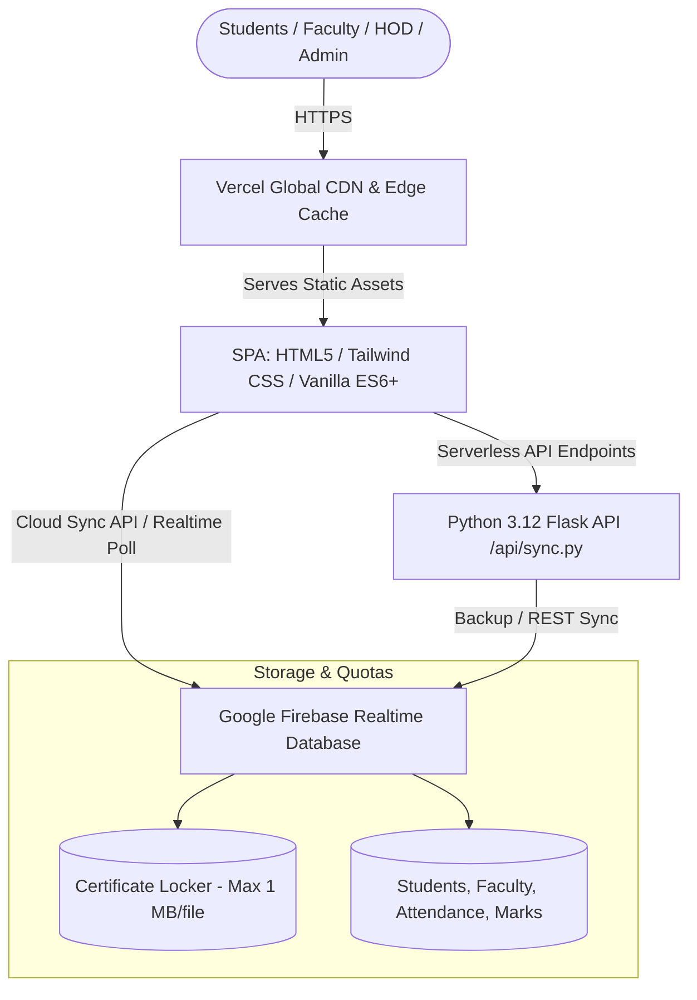

# 🎓 NMIET ECE ERP System

[](https://ece-campus-erp-8qn9.vercel.app)
[](https://nmiet.edu.in)
[](https://firebase.google.com)
[](https://python.org)

> **Official Institutional Enterprise Resource Planning (ERP) System**  
> **Nutan Maharashtra Institute of Engineering & Technology (NMIET), Talegaon Dabhade, Pune**  
> *Department of Electronics & Computer Engineering (ECE)*  
> **Head of Department:** Dr. Dhanashree Kulkarni

---

## 🚀 Live Deployment

- **Production URL:** [https://ece-campus-erp-8qn9.vercel.app](https://ece-campus-erp-8qn9.vercel.app)
- **Deployment Platform:** Vercel Serverless Functions + Global Edge Network
- **Sync Architecture:** Multi-client Realtime Synchronization powered by Google Firebase Realtime Database (`ece-campus-erp-default-rtdb`)

---

## ✨ Core Capabilities & Portals

The Campus ERP system provides granular, role-based workflows for students, teaching faculty, and institutional administrators.

### 1. 👨‍🎓 Student Portal
- **PRN-Based Authentication:** Clean sign-in with Permanent Registration Number (PRN) or student email.
- **Certificate Management & Cloud Locker:**
  - Direct student submission of academic, MOOC (NPTEL/Coursera), extracurricular, and internship certificates.
  - **Strict 1 MB Upload Limit:** Client-side binary validation immediately prevents oversized payloads, preserving cloud storage quotas and optimizing real-time sync performance.
  - **Smart Client-Side Image Optimization:** Automatically scales and compresses student certificate captures while maintaining legible resolution for faculty verification.
  - **59+ Historical Student Records Preserved:** Continuous sync without accidental database overwriting.
- **Academic Dashboard:** Real-time subject-wise attendance metrics, internal assessment scores, university notices, and daily timetable.

### 2. 👩‍🏫 Faculty Portal
- **Verified Faculty Roster (8 Designated Department Members):**
  - Dr. Dhanashree Kulkarni (HOD)
  - Prof. P.B. Patil
  - Dr. Vrushali Gujar
  - Prof. Ashwini B.
  - Prof. S.K. Mohite
  - Prof. R.D. Joshi
  - Prof. M.V. Kulkarni
  - Prof. N.A. Salunke
- **Daily Attendance Marking Engine:** Lecture, practical, and tutorial attendance recording with single-click bulk submission and instant percentage recalculation.
- **Continuous Assessment:** Submission of test scores, term work, and practical evaluation.
- **Certificate Verification Desk:** Real-time review, approval, or rejection of student achievement submissions.

### 3. 🏛️ Head of Department (HOD) & Administrative Command Center
- **Institutional Analytics:** Live aggregated student attendance charts, faculty workload distributions, and low-attendance alerts (< 75%).
- **Student Database Management:** Full roster oversight, section and batch assignment, and student status management.
- **Dynamic Timetable Engine:** Automated scheduling for lectures, laboratory sessions, room allocations, and faculty assignments.
- **Accreditation Export:** Instant generation of NAAC / NBA audit reports and department logs.

---

## 🏗️ System Architecture



---

## 🛠️ Technology Stack

| Layer | Technologies |
| :--- | :--- |
| **Frontend Client** | HTML5, Tailwind CSS (Glassmorphism design system), Vanilla ES6+ JavaScript, Lucide Icons |
| **Backend API** | Python 3.12, Flask, Vercel Serverless Python Runtime (`@vercel/python`) |
| **Database & Sync** | Google Firebase Realtime Database (`https://ece-campus-erp-default-rtdb.firebaseio.com`) |
| **Hosting & CI/CD** | Vercel Edge Network, GitHub VCS integration |
| **Document Generation** | ReportLab, Canvas PDF engines for official department credentials & attendance exports |

---

## 📂 Repository Structure

```text
campus-erp/
├── api/
│   └── sync.py              # Serverless sync endpoint for Vercel
├── static/
│   ├── css/
│   │   └── style.css        # Custom styles & animations
│   └── js/
│       ├── api.js            # Core data store, Firebase sync & REST engine
│       ├── app.js            # Router, state management & initialization
│       ├── supabase-cloud.js # Cloud upload and payload compression
│       └── views/
│           ├── auth.js       # Login & credential verification
│           ├── student.js    # Student dashboard, certificates & attendance
│           ├── teacher.js    # Faculty attendance & marks portal
│           ├── hod.js        # HOD dashboard & management controls
│           └── admin.js      # System configuration & audit logs
├── app.py                  # Local development Flask server
├── index.html               # Main SPA entry point
├── requirements.txt         # Python dependencies
├── vercel.json              # Vercel serverless routing configuration
└── README.md                # Project documentation
```

---

## 💻 Local Development Setup

### Prerequisites
- Python 3.10+ installed
- Modern web browser (Chrome, Firefox, Safari, Edge)
- Git

### 1. Clone the Repository
```bash
git clone https://github.com/NickXBT/ece-campus-erp.git
cd ece-campus-erp
```

### 2. Set Up Virtual Environment (Optional but Recommended)
```bash
python -m venv venv
# Windows:
venv\Scripts\activate
# macOS/Linux:
source venv/bin/activate
```

### 3. Install Dependencies
```bash
pip install -r requirements.txt
```

### 4. Run Local Server
```bash
python app.py
```
Open your browser and navigate to:
```text
http://localhost:5000
```

---

## 🔒 Security & Upload Policies

1. **Certificate Quota Enforcement:**
   - Any uploaded certificate (PDF, JPG, PNG) is verified client-side before processing.
   - Files exceeding **1 MB** (1,048,576 bytes) are rejected with a clear user prompt, avoiding cloud buffer overflows.
2. **Realtime Integrity Protection:**
   - Database operations use atomic field-level merges so simultaneous uploads and attendance entries do not overwrite existing records.
3. **Role-Based Access Control (RBAC):**
   - Access to student rosters, faculty modifications, and administrative analytics is protected at both the router and API validation layers.

---

## 📦 Deployment to Vercel

The application is configured for zero-configuration continuous deployment with Vercel:

```bash
# Deploy to production
npx vercel --prod
```

Or commit and push directly to the `main` branch:
```bash
git add .
git commit -m "feat: updates"
git push origin main
```
The Vercel GitHub Action / Webhook automatically triggers build and deployment to the live URL.

---

## 📝 License & Credits

- Developed for the **Department of Electronics & Computer Engineering (ECE)** at **Nutan Maharashtra Institute of Engineering & Technology (NMIET)**.
- Maintained by the ECE Department Technical Team.
